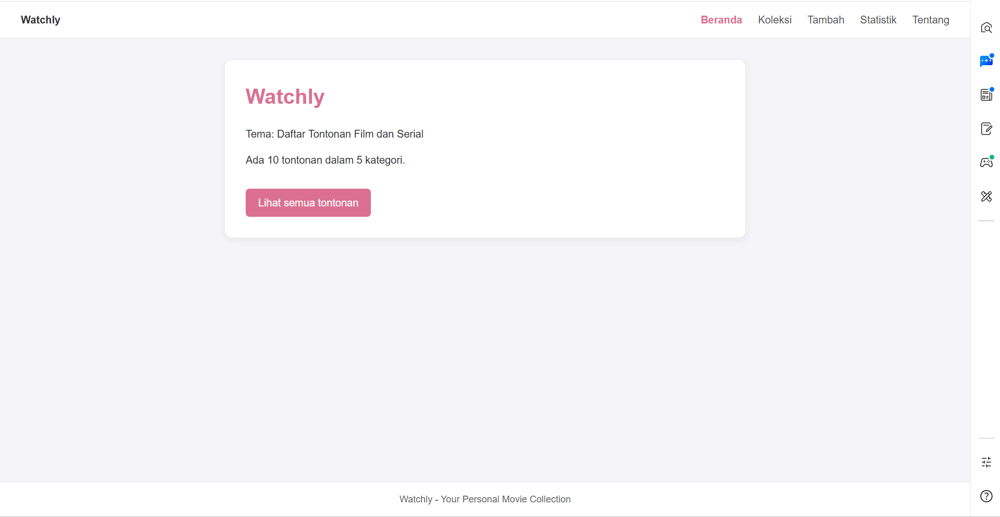

# Watchly
```
Nama : PRAY FEBRY VALENTINE. SG
NIM: 124140184
Kelas: RB
Tema: Daftar Tontonan Film dan Serial
Deployment: https://praysg.github.io/uts-paw/
```


## Fitur

- **Beranda**: Menampilkan ringkasan jumlah tontonan dan total kategori secara dinamis.
- **Koleksi**: Menampilkan daftar tontonan lengkap dengan fitur pencarian berdasarkan judul dan filter kategori.
- **Detail**: Menampilkan informasi lengkap tontonan (kategori, sutradara, tahun rilis, rating) serta opsi untuk menghapus item.
- **Tambah**: Menyediakan formulir interaktif untuk menambah tontonan baru dengan validasi input judul.
- **Statistik**: Menyajikan rangkuman rekapitulasi data dan kategori tontonan.
- **Tentang**: Menampilkan informasi profil pembuat, kelas, NIM, dan tautan repositori kode sumber.
- **Penyimpanan Lokal (`localStorage`)**: Menyimpan data koleksi secara persisten di browser pengguna.

## Menjalankan secara lokal

```bash
cd app
npm install
npm run dev
```
## Konsep React yang dipakai

- **Functional Components & JSX**: Menyusun struktur UI halaman serta komponen modular yang dapat digunakan kembali (seperti `KartuItem` dan `KotakPencarian`).
- **React Router**: Mengatur sistem navigasi multi-halaman, layout bersama (`Outlet`), rute dinamis detail tontonan (`/koleksi/:id`), serta penanganan rute tidak ditemukan.
- **Context API & Custom Hooks**: Menggunakan `KoleksiProvider`, `useKoleksi`, dan `useLocalStorage` untuk mengelola serta membagikan state data secara global di seluruh komponen.
- **Hooks Bawaan React**: Memanfaatkan `useState` untuk manajemen state lokal (formulir, pencarian, filter), `useEffect` untuk efek samping/penyimpanan, serta `useNavigate` dan `useParams` untuk navigasi programatik dan pembacaan parameter URL.
- **Controlled Components & Conditional Rendering**: Mengontrol elemen input formulir melalui state serta merender elemen secara kondisional (seperti status muat, pesan galat, dan kondisi data kosong).
- **Rendering Daftar (List Rendering)**: Menampilkan elemen koleksi data, pilihan kategori, dan statistik menggunakan metode `.map()` disertai atribut `key` yang unik.
